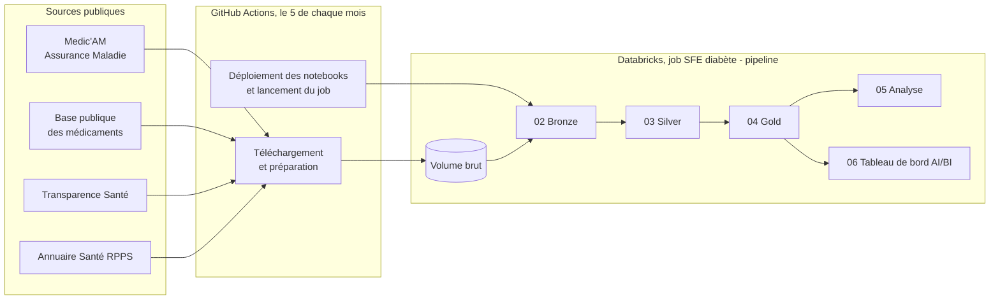
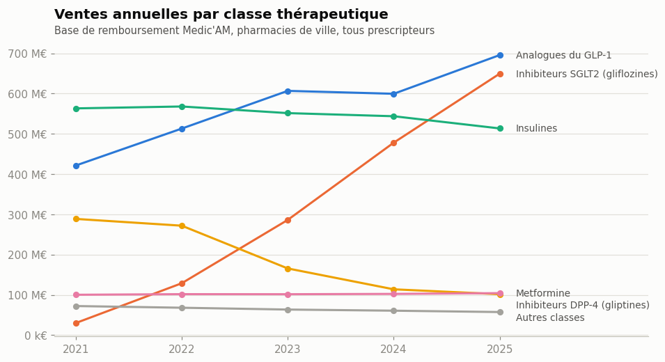
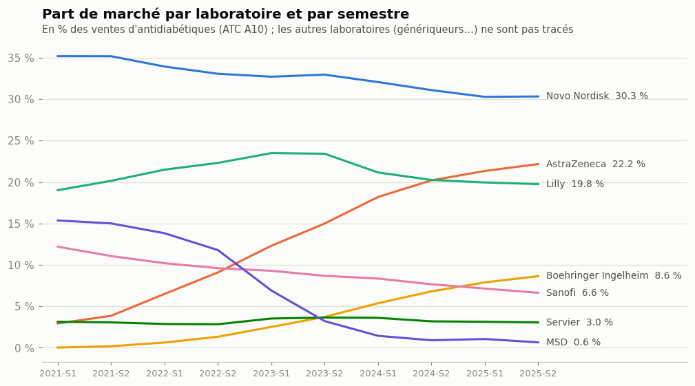
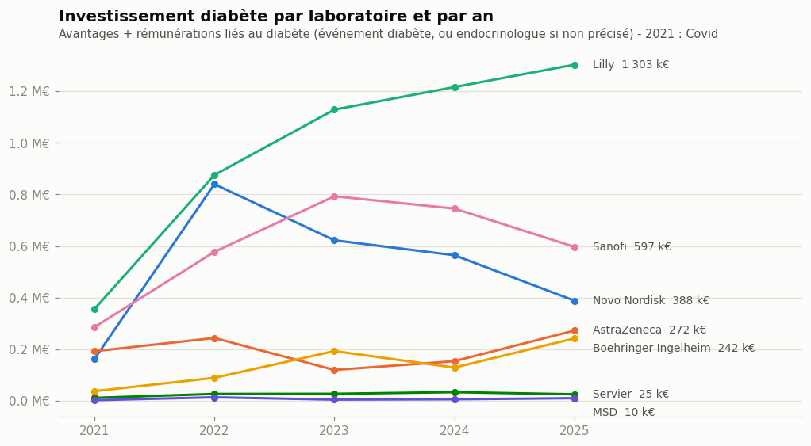
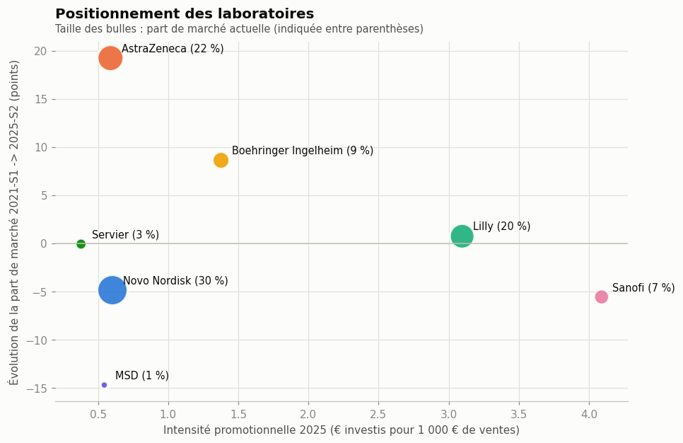

# Analyse concurrentielle du marché du diabète en France (2021-2025)

Projet de fin d'études (SFE) : une chaîne de traitement de données **automatisée de bout en bout** sur
**Databricks**, qui croise les ventes de médicaments antidiabétiques et les investissements des laboratoires
auprès des médecins, à partir de **données publiques officielles uniquement**.

**Questions étudiées**
1. Comment évolue le marché des antidiabétiques, et quelles classes thérapeutiques le portent ?
2. Quels laboratoires gagnent ou perdent des parts de marché, et avec quels produits ?
3. Combien, comment et auprès de quels médecins les laboratoires investissent-ils ?
4. L'investissement d'un semestre est-il suivi d'une hausse des ventes ?

---

## Architecture



**Pourquoi GitHub Actions ?** Databricks Free Edition bloque l'accès à Internet depuis les notebooks. Les données
sont donc téléchargées dans le cloud GitHub, puis déposées dans un Volume Unity Catalog via l'API Databricks.
GitHub Actions copie ensuite les notebooks dans l'espace Databricks et lance le job qui les enchaîne.

| Couche | Notebook | Contenu |
|---|---|---|
| Ingestion | [`scripts/preparer_donnees.py`](scripts/preparer_donnees.py) | Téléchargement des 4 sources, réduction RGPD du fichier RPPS, envoi dans le Volume |
| Bronze | [`02_bronze_tables`](notebooks/02_bronze_tables.py) | Fichiers bruts chargés tels quels en tables Delta (Medic'AM mis au format long) |
| Silver | [`03_silver_nettoyage`](notebooks/03_silver_nettoyage.py) | Référentiel médicament → laboratoire, classes thérapeutiques (ATC), médecins, déclarations typées, contrôles qualité |
| Gold | [`04_gold_indicateurs`](notebooks/04_gold_indicateurs.py) | Parts de marché, investissements, couverture des endocrinologues, rapprochement investissement / ventes |
| Analyse | [`05_analyse`](notebooks/05_analyse.py) | Graphiques et conclusions |
| Restitution | [`06_tableau_de_bord`](notebooks/06_tableau_de_bord.py) | Tableau de bord Databricks AI/BI publié (3 pages, filtres) |
| Orchestration | [`scripts/job_databricks.py`](scripts/job_databricks.py), [`ingestion.yml`](.github/workflows/ingestion.yml) | Déploiement des notebooks, création et lancement du job |

## Sources de données

| Source | Producteur | Utilisation | Équivalent privé |
|---|---|---|---|
| [Medic'AM](https://www.data.gouv.fr/fr/datasets/medicam-medicaments-rembourses-par-lassurance-maladie-par-type-de-prescripteur-donnees-interregimes/) (mensuel) | Assurance Maladie | Ventes par médicament (CIP13), mois et type de prescripteur | GERS |
| [Base publique des médicaments](https://base-donnees-publique.medicaments.gouv.fr/) | ANSM / Ministère de la Santé | Lien médicament → laboratoire titulaire, princeps / générique | — |
| [Transparence Santé](https://www.transparence.sante.gouv.fr/) | Ministère de la Santé | Avantages, rémunérations et conventions des laboratoires envers les médecins | — |
| [Annuaire Santé RPPS](https://www.data.gouv.fr/fr/datasets/annuaire-sante-extractions-des-donnees-en-libre-acces-des-professionnels-intervenant-dans-le-systeme-de-sante-rpps/) | Agence du Numérique en Santé | Spécialité et mode d'exercice des médecins | OneKey |

**Protection des données (RGPD)** : aucun nom, prénom, adresse, téléphone ni e-mail n'est téléchargé ni stocké ;
les médecins sont identifiés uniquement par leur numéro RPPS.

## Principaux résultats

| | |
|---|---|
|  |  |
|  |  |

- **Le marché passe de 1,5 à 2,1 Md€** entre 2021 et 2025 (+9,5 % par an), porté par les **gliflozines (SGLT2)**
  et les **analogues du GLP-1** ; les gliptines s'effondrent avec l'arrivée des génériques.
- **AstraZeneca (+19 points) et Boehringer Ingelheim (+9 points)** sont les grands gagnants grâce à Forxiga et
  Jardiance, aussi prescrits dans l'insuffisance cardiaque et rénale. **MSD perd 15 points** (génériques de Januvia).
- **Lilly est le premier investisseur** sur le diabète (4,9 M€ sur 5 ans) et a la meilleure couverture des
  endocrinologues depuis fin 2021 (34,5 % touchés au dernier semestre) ; **Sanofi** a l'intensité promotionnelle la plus forte pour défendre ses insulines.
- **Aucun lien statistique robuste** entre l'investissement d'un semestre et les ventes du suivant
  (corrélation de Spearman ≈ 0) : les ventes sont d'abord portées par des facteurs structurels
  (nouvelles indications, génériques, pénuries).

## Choix méthodologiques

- **Ventes** = base de remboursement Medic'AM (≈ chiffre d'affaires au prix public), pharmacies de ville.
- **Laboratoire** = titulaire de l'autorisation de mise sur le marché, regroupé par groupe pharmaceutique
  (Biogaran → Servier ; Merck Santé → Merck KGaA, à ne pas confondre avec MSD).
- **Investissement** = avantages + rémunérations réellement versés ; les conventions (montants prévus,
  redéclarés ensuite) sont comptées mais pas additionnées, pour éviter les doubles comptes.
- **Ciblage diabète** : chaque paiement est rattaché à sa convention pour retrouver l'événement, classé par
  mots-clés (diabète, obésité, cardio-rénal, autres aires) ; à défaut, la spécialité du médecin est utilisée.
- **Cycle** = semestre ; évolutions calculées par rapport au même semestre de l'année précédente.
- **Contrôles qualité** à chaque couche : 60 mois présents, ventes rattachées à un laboratoire à 99,98 %,
  cohérence ville + hôpital = total, parts de marché sommant à 100 %, unicité des médecins.

## Limites

- Marché de ville uniquement (pas la consommation à l'hôpital).
- Une partie des ventes de gliflozines relève de l'insuffisance cardiaque et rénale, pas du diabète.
- Transparence Santé ne déclare ni le produit promu ni la visite médicale ; le ciblage diabète est une estimation,
  moins précise pour AstraZeneca, Boehringer Ingelheim et MSD (avantages rarement rattachés à une convention).
- 10 semestres seulement : le rapprochement investissement / ventes est descriptif, pas causal.

## Lancer le projet

1. **Databricks Free Edition** : créer un espace sur [databricks.com](https://www.databricks.com/learn/free-edition),
   puis un jeton d'accès personnel (*Settings → Developer → Access tokens*).
2. **Secrets GitHub** (*Settings → Secrets and variables → Actions*) :
   `DATABRICKS_HOST` (adresse de l'espace, ex. `https://dbc-xxxx.cloud.databricks.com`) et `DATABRICKS_TOKEN`.
3. **Lancer** : *Actions → Ingestion des données vers Databricks → Run workflow*. Le workflow télécharge les données,
   déploie les notebooks dans `Workspace/Users/<email>/sfe_diabete_pipeline`, crée le job
   « SFE diabète - pipeline » et le lance. Décocher « Télécharger à nouveau les données » pour relancer
   seulement les traitements.
4. **Résultats** : tables dans *Catalog → workspace → sfe_diabete*, tableau de bord dans
   *Dashboards → Marché du diabète - SFE*.

Le workflow s'exécute aussi automatiquement le 5 de chaque mois.

## Structure du dépôt

```
.github/workflows/ingestion.yml   Workflow GitHub Actions (ingestion + lancement du job)
scripts/preparer_donnees.py       Téléchargement, préparation et envoi des données
scripts/job_databricks.py         Déploiement des notebooks, création et lancement du job Databricks
notebooks/                        Notebooks Databricks (01 ingestion directe, 02 à 06 traitement)
sources/medicam/                  Copie des fichiers officiels Medic'AM (ameli.fr refuse GitHub Actions)
docs/figures/                     Graphiques du notebook 05
```

**Technologies** : Databricks (Unity Catalog, Delta Lake, PySpark, Spark SQL, Jobs serverless, AI/BI Dashboards),
GitHub Actions, Python (pandas, matplotlib).
